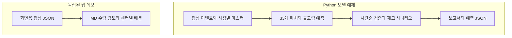

# 7-Eleven · Inventory Analytics

**신상품 초기 출고량 예측, 시간순 검증과 발주 수량별 재고 비교**

[](https://github.com/daniel5781/7Eleven_MD_Dashboard/actions/workflows/modeling.yml)
[](https://github.com/daniel5781/7Eleven_MD_Dashboard/actions/workflows/pages.yml)

[**모델 코드와 실행 →**](modeling/README.md) · [설계와 검증](docs/PROJECT.md) · [원본 코드와의 대응](modeling/SOURCE_MAP.md) · [대시보드 체험](https://daniel5781.github.io/7Eleven_MD_Dashboard/)

신상품의 예약 정보를 바탕으로 상품 × 물류센터별 초기 출고량을 예측하고,
발주 수량이 과소·과다해질 때의 재고 부담을 비교하는 산학협력 팀 프로젝트입니다.
이 저장소는 로컬 v6 모델의 핵심 구조를 공개용 코드로 정리하고, 합성 데이터로 재현 가능한 실행 예제를 제공합니다.

> **공개본의 데이터와 실행 결과는 모두 합성 예시입니다.** 기업 원자료, 기존 학습 가중치와 실제 예측 결과는 포함하지 않습니다. 여기서 측정한 점수는 실제 모델 성능이나 비용 절감 실적이 아닙니다.

## 공개본의 두 실행 흐름

업무에서는 예측과 재고 분석을 MD의 수량 검토에 활용합니다.
현재 공개 구현은 Python 모델 예제와 웹 데모를 각각 실행하는 구조입니다.



두 흐름 사이의 자동 연결은 구현하지 않았습니다. 출력 키·단위와 필요한 변환은
[모델 출력과 대시보드 연결](modeling/README.md#출력과-대시보드-연결)에 정리했습니다.

| 단계 | 공개 구현 |
| --- | --- |
| 전처리·피처 | 결정일 기준 예약 집계, 예약 속도·집중도, 상품 경제성, 센터 비중, 과거 공동예약 이웃 |
| 예측 | 예약량 대비 출고 배수를 학습하는 LightGBM 5개 시드 앙상블 |
| 추가 실험 | 배수·원수량·로그 타깃을 검증 구간에서 결합하는 3타깃 블렌드 |
| 검증 | 시간순 홀드아웃, 라벨 확정 시점에 따른 경계 제외, 월별 walk-forward |
| 운영 비교 | 검증 구간에서 선택한 α 보정, 과소·과다 발주 물량, 재고 보유량 시나리오 |
| 활용 화면 | 독립된 합성 JSON으로 상품 상세, 예약 추이, 추천량 검토, 센터별 배분과 과거 상품 조회 |

## 모델의 핵심

**타깃은 출시일부터 4일간의 센터 → 점포 출고량입니다.**
고객의 최종 수요, 실제 초도 발주량, 최적 재고량은 각각 다른 개념입니다.

```text
학습 타깃 = 4일 출고량 / 결정일까지의 예약량
출고 예측 = 예약량 × 예측 배수
운영 시나리오 수량 = 출고 예측 × α
```

원본 전달 패키지의 배수 모델과 30개 수치·3개 범주형 피처 구성을 유지했습니다.
고정 공식, 학습 구간에서 재산정한 공식, 모델 예측, α 보정 결과를 함께 비교합니다.
블렌드는 별도 실험 방식으로 제공하며 전달 패키지의 기본 모델과 구분합니다.

## Python 모델 실행

Python 3.13 기준입니다. 저장소 루트에서 실행합니다.

```bash
python3.13 -m venv .venv
source .venv/bin/activate
python -m pip install -r modeling/requirements-lock.txt
python -m modeling.demo --trees 200 --walk-forward
python -m modeling.demo --mode blend --trees 200 --output modeling/output/blend
python -m unittest discover -s modeling/tests -v
```

원본 자료 없이 **가상 이벤트 생성 → 전처리 → 학습 → 평가 → 재고 비교 → 저장·추론**까지 실행합니다.
생성된 모델과 예측표는 Git에서 제외한 `modeling/output/`에 저장됩니다.
실행 예시는 [합성 데이터 검증 보고서](modeling/examples/synthetic-report.json)에서 확인할 수 있습니다.

## 대시보드 실행

```bash
npm ci --ignore-scripts
npm run dev
```

Node.js 24 이상을 사용하며, 이름은 자유롭게 입력하고 데모 코드 **711**로 접속합니다.
접속 코드는 화면 흐름을 보여주는 장치이며 인증 기능이 아닙니다.

현재 웹 데모는 `public/data/`의 독립된 합성 JSON을 사용합니다.
Python 모델 실행 결과는 자동으로 웹에 반영되지 않습니다.
모델 예제와 웹 데모의 데이터 규모·숫자는 다르며, 연결 방식은 [데이터 계약](modeling/README.md#출력과-대시보드-연결)에 설명했습니다.

## 개인 기여

**PM · 데이터 전처리 · 예측 모델 검증 · 재고 시뮬레이션 · 대시보드 구현**

프로젝트 진행과 분석·검증을 맡고, 결과를 발주 의사결정 화면에 연결하는 구현에 참여했습니다.
모델 실험, 검증 관점과 팀 결과물의 관계는 [프로젝트 설명](docs/PROJECT.md)에 정리했습니다.

## 구조와 출처

```text
modeling/                    모델·피처·검증·재고 시나리오와 테스트
modeling/examples/           합성 데이터 실행 보고서
src/                         React 대시보드
public/data/                 웹 화면용 합성 JSON
scripts/                     웹 합성 데이터 생성·검사
docs/PROJECT.md               문제 정의·검증 관점·개인 기여
.github/workflows/           모델 검사·웹 배포
```

모델 코드는 로컬 v6의 베이스라인·전달 패키지·재고 분석 코드에서 가져온 방법을 공개용으로 재구성했습니다.
[파일별 대응과 변경점](modeling/SOURCE_MAP.md)에 원본 코드의 해시와 유지·변경 범위를 남겼습니다.

대시보드의 팀 원본은 [Geonhohoho/7Eleven_MD_Dashboard](https://github.com/Geonhohoho/7Eleven_MD_Dashboard),
기준 커밋은 [21c6455](https://github.com/Geonhohoho/7Eleven_MD_Dashboard/commit/21c6455adc1a9995f5d4cbc49dec78166eca1a6c)입니다.
팀 결과와 개인 담당 범위를 함께 표기합니다.

원본 자료·학습 가중치·원본 Git 이력·API 키는 공개본에 포함하지 않았습니다.
원본에 별도 라이선스 파일이 없어 새로운 오픈소스 라이선스를 임의로 부여하지 않았습니다.
