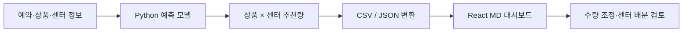

# 신상품 초도발주 의사결정 지원

## 프로젝트 맥락

세븐일레븐 산학협력 팀 프로젝트의 최종 대시보드를 소개합니다.
신상품 출시 전에 확보할 수 있는 예약 정보로 초도물량을 검토하고,
MD가 상품·센터별 추천량을 조정하는 흐름에 초점을 둡니다.

## 모델에서 화면까지

팀 원본의 `scripts/generate_future_final_model_predictions.py`는
`initial_order_model.InitialOrderModel`을 가져오고 `artifact/`를 읽어 추천량을 생성합니다.
로컬 v6 모델 전달 패키지도 같은 인터페이스를 사용합니다.
이 구조적 연결을 확인했으며, 양쪽 모델 가중치가 동일한지는 검증하지 않았습니다.

공개본은 이 흐름의 **화면과 데이터 계약**을 보여줍니다.
실제 모델을 실행하지 않고 독립적으로 생성한 합성 예약·추천·판매 수치를 사용합니다.

## 분석을 설명할 때의 기준

- 실제 발주량, 센터 출고량, 점포 판매량을 구분합니다.
- 예측 시점에 이용할 수 있는 정보만 입력으로 사용하도록 검토합니다.
- 상품·센터 단위의 오차와 운영 의사결정 지표를 함께 살펴봅니다.
- 모델 평가 수치와 대시보드의 예시 숫자를 구분합니다.
- 개선 가능성을 실제 재고 비용 절감 실적으로 단정하지 않습니다.

## 기여와 공개 범위

Daniel은 **PM, 데이터 전처리, 예측 모델 검증, 재고 시뮬레이션, 대시보드 구현**을 담당했습니다.
팀 최종 대시보드의 전체 구현과 개인의 담당 업무를 구분해 소개합니다.

| 영역 | 설명 |
| --- | --- |
| 원본 대시보드 | 팀 저장소의 React·Vite 구현. 원본 작성자와 커밋을 README에서 연결 |
| 모델 연결 | Python 모델의 추천량을 화면용 테이블로 전달하는 구조 |
| 이 공개본 | 합성 데이터, 외부 서비스 없는 실행, 출처 표기, 빌드·공개 데이터 검사 |
| 비공개 자료 | 기업 원자료·모델 가중치·실제 예측 결과·내부 발표 자료 |

원본 팀 저장소의 커밋 작성자와 개인의 분석 기여는 서로 다른 증거입니다.
이 공개본의 생성 커밋이나 UI 복제 자체를 원본 프로젝트의 개인 개발 기여로 계산하지 않습니다.
